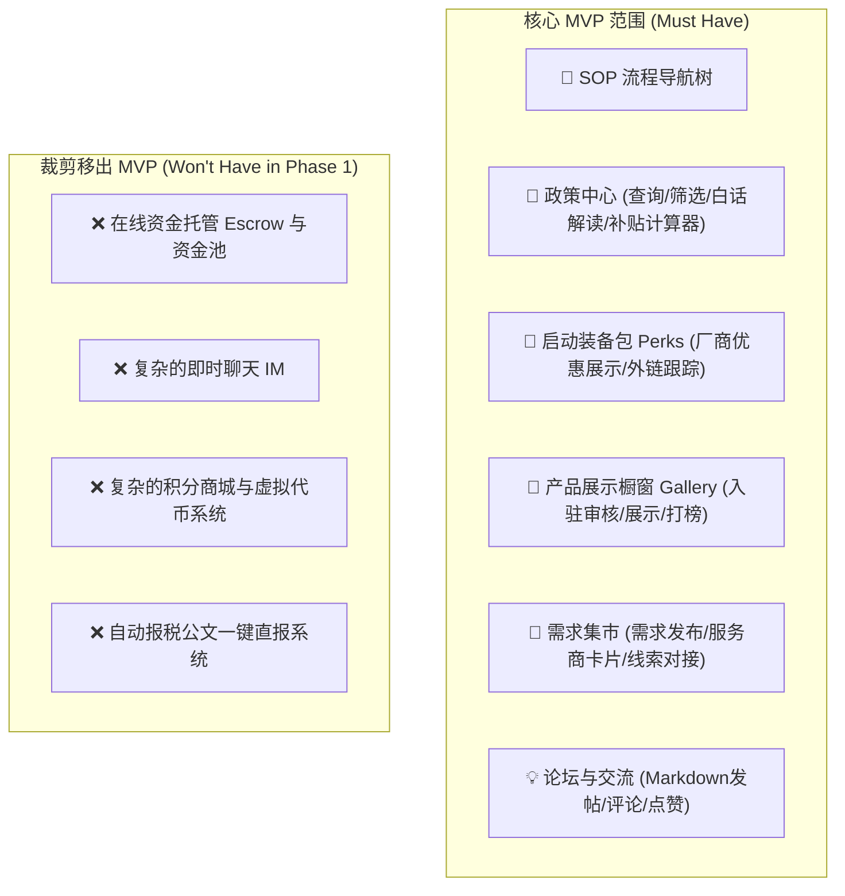

# OpcHub MVP 产品需求规格说明书 (PRD)

> **Document Type**: Feature Construction Specification (Human PRD)  
> **Inherits**: `/DESIGN.md`  
> **Metadata**: `intent=BUILD`, `change_size=L`, `work_mode=DESIGN`, `phase=0`, `version=v1.0.0`  
> **Author**: hardstone (Product Owner) & Antigravity (Product Partner)  
> **Status**: READY_FOR_ACCEPTANCE (阶段 0 冻结候选)

---

## 1. 0A 需求理解与业务对账 (DISC Checklist)

### 1.1 真实场景与现状痛点 (Status Quo & Pain Points) [DISC-01]
- **触发情境**：随着 AI 大模型、代码辅助工具和低代码基础设施普及，越来越多的技术人员、产品经理、自媒体人和创作者选择成为**一人公司（One Person Company, OPC）/ 超级个体**。
- **现状困难 (Status Quo)**：
  1. **政策信息孤岛**：各级政府关于“小微企业、科技型初创、个人独资企业/个体户”的减税、真金补贴政策分散在数十个官方网站，行文晦涩，申报门槛不透明，OPC 几乎无法及时获取红利；
  2. **算力与基建烧钱**：单兵作战需采购 GPU/Token 算力、云服务器、域名、SaaS 工具，零售价格高昂，没有企业级折扣通道；
  3. **产品发布无门**：产品做出后缺乏首发冷启动渠道，传统渠道获客成本极高；
  4. **短板难以弥补**：一人公司缺乏记账报税、UI 设计、合规审查等能力，外包踩坑率极高。
- **用户雇佣任务 (JTBD)**：
  - *When* 我作为一名 OPC 启动或运营我的独立业务时；
  - *I want to* 一站式获取量身定制的政策红利、算力与服务器折扣、分步避坑向导，并能发布产品及对接外包；
  - *So I can* 以最低成本、最低合规风险、最快速度跑通盈利闭环。

### 1.2 目标与反目标 (Goals & Non-Goals) [DISC-02]
- **本期核心目标 (Goals)**：
  1. 提供高信噪比的**政策中心**（智能抓取、白话提炼、补贴测算）；
  2. 提供主流 Token 与云厂商的**启动装备包 (Perks)** 及专属优惠跳转；
  3. 提供 OPC **全生命周期 SOP 步骤树**（从注册合规到变现）；
  4. 提供创客**产品展示橱窗 (Product Gallery)**，支持基础审核上架与打榜推荐；
  5. 提供轻量**交流论坛与依赖需求集市**（外包需求发布与服务商认证连接）。
- **反目标 (Non-Goals - MVP 明确不做)**：
  - ❌ 不做自营线下孵化器或实体办公空间租赁；
  - ❌ 不做重型在线代记账 ERP 软件开发（初期仅做政策科普与合规服务商撮合）；
  - ❌ 不做重型资金托管（Escrow）与在线仲裁系统（初期采用轻量线索与资质认证撮合模式）；
  - ❌ 不做复杂的实时 IM 即时通讯系统（初期直接引导通过创客公开联系方式/微信/社交账号直联）。

### 1.3 核心术语与关键动词 (Domain Glossary) [DISC-03]
| 术语 | 英文标识 | 平台内唯一定义与业务含义 |
| :--- | :--- | :--- |
| **一人公司** | `OPC` | 拥有独立商业产品、依靠个人+AI实现闭环运作的超级个体或个体工商户/小微法人主体。 |
| **政策条目** | `PolicyItem` | 经平台抓取并由 AI 结构化提炼的政府扶持、税收减免、资金补贴条例。 |
| **启动装备包** | `PerkItem` | 平台与第三方 Token/云厂商合作提供的专属折扣码、大额抵扣金或返佣链接。 |
| **产品橱窗** | `GalleryProduct` | 经审核收录并在官方展厅展示的 OPC 原创产品（SaaS、工具、应用）。 |
| **依赖需求** | `ServiceDemand` | OPC 发布的寻找代理记账、UI设计、定制开发等轻量外包协作需求。 |
| **认证服务商** | `VerifiedVendor` | 通过平台资质审查的财税所、律师、独立设计师等第三方专业供给方。 |

### 1.4 假设与裁决矩阵 (Confirmed / Derived / Open) [DISC-05]
| 事项 | 类型 | 裁决结论与依据 |
| :--- | :--- | :--- |
| **系统架构模式** | `CONFIRMED` | **重后端、薄前端（API-First）**，首发响应式 Web 控制台，预留微信小程序与插件多端接入能力。 |
| **商业变现模式** | `CONFIRMED` | **多维收费体系**（Token/云厂商渠道返佣 + 展位赞助费 + Gallery 上架费与打榜费 + 服务商认证费）。不在前台定死金额，通过变现标识区分。 |
| **政策入库机制** | `CONFIRMED` | 采取**强结构化 Schema + LLM 大白话提炼**（而非纯向量搜索），确保多端条件组合筛选与高精度推荐。 |
| **服务交易模式** | `CONFIRMED` | **轻量线索撮合 + 资质认证制**，平台不介入强担保资金流，规避二清与法务合规风险。 |

---

## 2. 0B MVP 范围裁定 (CEO 质疑式裁剪)



- **Q1 单一核心假设**：如果 OpcHub 只保留一个功能还能成立，那个功能是：**“让 OPC 零门槛获得能直接省钱/赚钱的精准政策红利与算力基建优惠（Perks）”**。
- **Q2 裁剪裁定**：坚决剔除重型客服、资金二清、重型代账后台，全站无重型后台管理拖累。
- **Q3 交付时间箱**：以轻量 API 快速实现首个端到端闭环验证。

---

## 3. 0C 原子化功能需求规格 (PROD Checklist)

### REQ-01：政策中心与补贴计算器 (Policy Center)
- **业务要求**：
  1. 支持按**主体类型**（个体工商户、个人独资企业、小微企业、个人创客）、**地域/省市**、**支持类型**（资金补贴、税收减免、创业孵化）进行多维度组合筛选；
  2. 每条政策卡片展示：政策标题、发文机构、AI 100字大白话核心要点、申报门槛硬指标、截止倒计时、官方直达链接与免责声明；
  3. **补贴计算器**：用户勾选自身状态（如：未注册/已有个体户、年营收预期、所在城市），系统即时匹配出《预计可申报政策列表》。
- **Gherkin 验收标准 (DoD)**：
  ```gherkin
  Scenario: 创客根据城市和主体筛选政策
    Given 政策库中存在不同城市和主体的有效政策
    When 用户在前端选择地域为 "杭州" 且主体类型为 "个体工商户"
    Then 系统返回所有符合条件且在有效期内的政策列表
    And 每条政策均包含 AI 白话提炼摘要和申报门槛标签
  ```

### REQ-02：启动装备包与生态优惠 (Perks & Deals)
- **业务要求**：
  1. 集中展示主流合作厂商（AI Token、云服务器、域名/SSL、出海工具等）的专属折扣与免费额度；
  2. 卡片标明：合作厂商名称、专属优惠权益、兑换方式（优惠码或专属注册外链）、适用范围；
  3. 外链跳转带平台专属渠道标识，记录点击与转化埋点（用于商业变现分成结算）；
  4. 支持置顶推荐位与赞助商标牌（`[收费点·厂商赞助]`）。
- **Gherkin 验收标准 (DoD)**：
  ```gherkin
  Scenario: 创客申领 Token 优惠码并跳转
    Given 存在有效的 SiliconFlow 专属 Perks 记录
    When 创客点击 "复制优惠码并前往官网"
    Then 优惠码自动复制到剪贴板
    And 浏览器新标签页打开附带平台渠道参数的注册链接
    And 后端异步记录一次 PerkClick 埋点事件
  ```

### REQ-03：创客合规 SOP 与标准化材料生成器 (SOP Document & Template Engine)
- **业务要求**：
  1. 结构化呈现 4 大合规关键主阶段：`阶段 01: 主体定名与税种选型` ➔ `阶段 02: 银行基本户与发票授信` ➔ `阶段 03: 软著申报与技术入库` ➔ `阶段 04: 跨境结汇通道配置`；
  2. **预置标准模板库 (`sop_templates`)**：内置符合政务与银行要求的标准化设立登记申请书、一人有限责任公司章程、软著申报材料鉴别表、跨境结汇真实性承诺书，定义必填校验与动态字段占位符；
  3. **后端微内核合规渲染与实例持久化 (`sop_documents`)**：创客在前端录入申报信息，后端自动完成参数清洗、合规校验、电子流水号签发（如 `VER-9F81A7BC-2026`）与排版，并将完整生成结果持久化存储，前端仅负责渲染展示并支持即时下载。
- **Gherkin 验收标准 (DoD)**：
  ```gherkin
  Scenario: 创客填报信息由后端渲染并持久化申报材料
    Given 创客已选定 "个体工商户设立登记标准申请书" 模板
    When 创客填写企业字号、法定代表人和经营范围并点击 "保存文书"
    Then 后端微内核完成合规校验并持久化保存至 sop_documents 表
    And 返回带有防伪核验流水号的标准公文文本供前端原样渲染
    And 创客点击 "导出文书" 可直接下载该持久化实例
  ```

### REQ-04：产品展示橱窗与打榜 (Product Gallery)
- **业务要求**：
  1. 创客可提交自己的独立产品（名称、Slogan、主图/Logo、产品链接、标签分类、详细介绍 Markdown）；
  2. **付费审核机制**：标记 `[收费点·创客付费]`，支付审核服务费后进入官方 Gallery 展示池；
  3. **产品主页**：为收录产品生成独立的详情页，附带 DoFollow 优质反向链接；
  4. **打榜置顶机制**：支持按周/月选购置顶展示位，增加在全站头部曝光权重。
- **Gherkin 验收标准 (DoD)**：
  ```gherkin
  Scenario: 创客提交产品入驻审核
    Given 创客填写完整的产品名称、链接及介绍
    When 创客完成上架费用支付并提交审核
    Then 产品进入待审核列表，状态标记为 "PENDING_REVIEW"
    And 审核通过后，产品正式进入官方 Gallery 并生成独立落地页
  ```

### REQ-05：依赖服务与外包需求集市 (Marketplace)
- **业务要求**：
  1. **需求发布**：OPC 免费发布外包与法律合规需求（涵盖 DEV 开发、AI 智能体、TAX 财税、LEGAL 法律求助四大类别，包含标题、预算范围、交付周期、技能要求、联系方式隐藏）；
  2. **法律合规专项通道**：支持针对 GDPR 出海审查、算法备案申报、免责协议起草等法律求助帖进行快速分类与合规专业服务商撮合；
  3. **服务商入驻**：合规律所、代理记账机构、代码开发者提交认证申请（资质证书、过往案例），平台审核后打上 `VerifiedVendor` 官方认证徽章；
  4. **线索匹配**：认证服务商可查看需求详情并申请对接，平台通过安全机制向双方披露联系通道（`[收费点·撮合佣金/线索费]`）。
- **Gherkin 验收标准 (DoD)**：
  ```gherkin
  Scenario: 创客发布法律求助需求并获专业服务商对接
    Given 创客发布了一条 "出海独立 SaaS 平台隐私协议与 GDPR 合规审查" 法律求助需求 (category: LEGAL)
    When 认证涉外合规律所或法务服务商点击 "申请竞标"
    Then 系统向创客发送法务服务商竞标方案与履约报价
    And 记录一条 MatchRecord 撮合线索事件
  ```

### REQ-06：创客头脑风暴与无限层级问答社区 (Community Brainstorm & Discussion Tree)
- **业务要求**：
  1. **讨论帖发布与分类**：支持 DEV、BIZ、TAX、AGENTS 分类发布实战经验与避坑帖；
  2. **物化路径无限层级问答回复 (`forum_comments`)**：采用物化路径模型（Materialized Path）+ 顶级回答索引，高效支撑顶级回答、楼中楼以及深层对回答的回答等无限嵌套评论树，后端 $O(N)$ 自动装配；
  3. **认同点赞 (`forum_upvotes`)**：一人一票严格防重原子切换机制，支持主帖与评论双重对象；
  4. **收藏归档 (`forum_bookmarks`)**：帖子防重收藏与自定义收藏夹分类归档。
- **Gherkin 验收标准 (DoD)**：
  ```gherkin
  Scenario: 创客发表楼中楼二级回复与认同点赞
    Given 讨论帖下已存在一条顶级回答 A
    When 创客 B 针对回答 A 提交一条子回复
    Then 后端自动生成物化路径 /root_id/parent_id/id 并递增 depth 为 1
    And 单次拉取主帖即可返回完整嵌套子树结构
    When 创客连续点击两次点赞按钮
    Then 计数精准执行 +1 与 -1 原子切换，无并发脏数据
  ```

### REQ-07：产品开发合规指南与风险自检引擎 (Product Compliance Guide & Self-Audit Shield)
- **业务要求**：
  1. **六维产品合规防线体系化展示**：系统呈现隐私保护、资金防二清、算法与上线备案、知识产权/开源许可证、数据跨境出境、UGC内容安全六大维度的合规要求与实施红线；
  2. **典型踩坑案例库**：收录行业内未做实名被责令整改、内嵌自建资金池被罚没、引入强传染开源代码导致强制开源等典型案例剖析；
  3. **上线前交互式合规体检雷达 (Interactive Self-Audit Checklist)**：提供 10 项标准化上线前自检清单，支持创客在线勾选打分，实时计算 0~100 综合合规指数，并给出针对性整改指引；
  4. **合规直通需求集市**：体检发现法务合规缺口时，支持一键将短板项直转生成需求集市的“法律求助”委托订单。
- **Gherkin 验收标准 (DoD)**：
  ```gherkin
  Scenario: 创客使用合规雷达完成上线前产品自检
    Given 创客进入合规指南页面并打开上线前自检清单
    When 创客完成 10 项核心合规检查项勾选
    Then 系统根据加权规则实时计算合规安全得分 (0~100)
    And 针对未通过的短板项高亮输出法律风险警示及《合规规约》建议
    When 创客点击 "法务求助"
    Then 自动带入自检未过项目跳转至需求集市发布页面
  ```


---

## 4. 0D 适用非功能与质量约束 (PROD-08)

1. **响应速度 (Performance)**：
   - 政策检索与卡片列表首屏 API 响应时间在 95% 分位下 $\le 200\text{ms}$；
   - 支持高并发缓存（政策与 Perks 静态缓存命中率 $\ge 90\%$）。
2. **多端自适应 (Multi-Client Readiness)**：
   - API 输出标准 RESTful / JSON 契约；
   - 界面无横向滚动条，移动端排版体验完美，适配屏幕宽度 $360\text{px} \sim 2560\text{px}$。
3. **全域合法合规与数据安全 (Legal & Compliance)**：
   - 严格执行架构规约 [`hs_dev_docs/_03_architecture_design/_02_system_architecture/opchub_legal_compliance_spec.md`](file:///home/hardstone/Share/Common/CodeSpace/OpcHub/hs_dev_docs/_03_architecture_design/_02_system_architecture/opchub_legal_compliance_spec.md)；
   - **政策采集安全**：仅采集 `gov.cn` 官方公开公文，严禁采集第三方商业数据库或涉密内部公文；限频低速错峰运行；
   - **政策出处与免责**：政策卡片必须标明发文机构与官方原件链接，强制渲染法律免责提示，禁止假借官方机关名义背书；
   - **UGC 内容治理**：敏感词 Trie 树前置拦截，前台一键举报直通 View 12 内容治理控制台，下架言论留痕存证，网络日志依法保留至少 180 天；
   - **身份与协议**：严格落实后台手机号实名、前台发帖 IP 属地强制展示；用户协议与隐私政策禁止默认勾选；
   - **金融防二清**：撮合交易款项与报酬全部对接持牌第三方支付机构分账，平台绝不设私有资金池。
