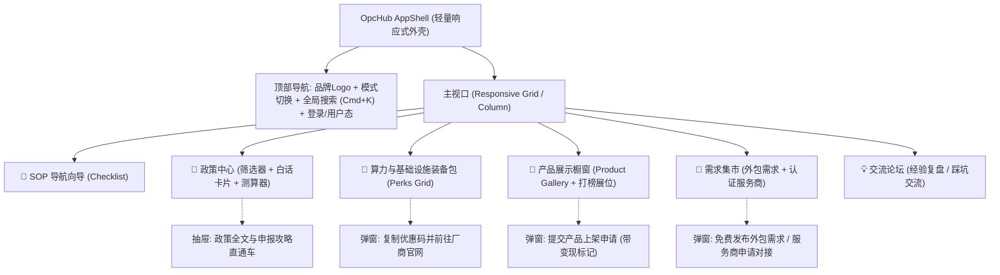

# OpcHub 双轨多态功能原型规格说明书 (Wireframe & Specs)

> **Document Type**: Feature Prototype Specification  
> **Inherits**: `/DESIGN.md`  
> **Metadata**: `intent=BUILD`, `change_size=L`, `work_mode=DESIGN`, `phase=0`, `version=v1.0.0`  
> **Status**: READY_FOR_ACCEPTANCE (阶段 0 冻结候选)

---

## 1. 轨一：Mermaid 全站空间划分与交互流转拓扑



---

## 2. 轨二：ASCII 空间比例线框图 (首屏核心工作区)

### 2.1 正常数据态 (Populated State - 1440px 桌面端视图)

```text
+--------------------------------------------------------------------------------------------------------------------+
|  [Logo] OpcHub     | 🧭 向导   📜 政策中心   🎁 装备包   🚀 橱窗   🤝 集市   💡 论坛 |  [ 🔍 搜索政策/Perks (Cmd+K) ]  [创客控制台] |
+--------------------------------------------------------------------------------------------------------------------+
|                                                                                                                    |
|  [⚡ 快速测算]  选择你的所在地: [ 杭州 ▾ ]   主体性质: [ 个体工商户 ▾ ]   年收入预估: [ 30万以内 ▾ ]    [ 🎯 一键测算补贴 ]   |
|                                                                                                                    |
|--------------------------------------------------------------------------------------------------------------------|
|  📜 精选高价值政策 (3 条新发布)                           |  🎁 热门开发者装备包 (已领 ¥18,500+)                      |
|                                                          |                                                          |
|  +----------------------------------------------------+  |  +----------------------------------------------------+  |
|  | 【税收优惠】小规模纳税人季度销售额 30 万以下免增值税   |  |  | 🟣 SiliconFlow · 大模型 Token 礼包                      |  |
|  | 🏛️ 财政部/税务总局   ⏳ 长期有效   🏷️ 税费减免          |  |  | 💎 专享 2000 万 Token 赠送 + 充值 8 折返佣通道          |  |
|  | 💡 [100字白话]: 只要每个季度不开发票或开普票不超过30万， |  |  | 🏷️ AI算力   🏷️ 官方直连       [ 领取专属优惠码 ]      |  |
|  |   免征增值税与附加税，极大减轻 OPC 现金流压力。        |  |  +----------------------------------------------------+  |
|  |                                [ 详情与申报指引 > ] |  |  +----------------------------------------------------+  |
|  +----------------------------------------------------+  |  | 🟠 阿里云 · 初创扶持计划                               |  |
|  +----------------------------------------------------+  |  | 💎 2核4G 云服务器低至 ¥68/年，送对象存储抵扣金        |  |
|  | 【科技补贴】高校毕业生/返乡创业一次性扶持 ¥10,000      |  |  | 🏷️ 云基建   🏷️ 厂商特惠       [ 前往申领 > ]          |  |
|  | 🏛️ 杭州市人社局   ⏳ 剩 18 天截止   🏷️ 现金补贴        |  |  +----------------------------------------------------+  |
|  | 💡 [100字白话]: 毕业 5 年内创办个体户或企业，连续正常  |  |                                                          |
|  |   经营满 6 个月即可直接申领一万元真金无偿补贴。        |  |  🚀 最新收录产品橱窗 (Product Gallery)                   |
|  |                                [ 详情与申报指引 > ] |  |  +----------------------------------------------------+  |
|  +----------------------------------------------------+  |  | 🚀 DevAgent: 一键生成营销短视频的开源工具               |  |
|                                                          |  |  👤 @alex (OPC)   ⭐ 128 Upvotes   [ 访问官网 ↗ ]    |  |
|                                                          |  +----------------------------------------------------+  |
+--------------------------------------------------------------------------------------------------------------------+
```

### 2.2 移动端自适应线框 (Mobile / 390px 视口单列流)

```text
+-----------------------------------+
| [≡] OpcHub            [🔍] [头像] |
+-----------------------------------+
| 🎯 测算: [杭州▾] [个体户▾] [GO]   |
+-----------------------------------+
| 📜 推荐政策 (2)                   |
| +-------------------------------+ |
| | 【免税】季度30万免增值税        | |
| | 💡 普票免征，大幅减免初期税负  | |
| | 🏷️ 税收减免        [查看指引] | |
| +-------------------------------+ |
+-----------------------------------+
| 🎁 独家装备包 (Perks)             |
| +-------------------------------+ |
| | 🟣 SiliconFlow 赠 2000w Token | |
| | [ 一键复制专属码并跳转 ↗ ]   | |
| +-------------------------------+ |
+-----------------------------------+
| 底部固定栏: [向导] [政策] [装备] [我的] |
+-----------------------------------+
```

---

## 3. 页面四态规范 (Four Mandatory States)

1. **正常数据态 (Populated State)**：如上 ASCII 线框展示，政策有列表、Perks 卡片清晰、具备明确的变现标记与跳转。
2. **空白引导态 (FTUE / Empty State)**：
   - 场景：用户首次使用，无浏览历史，或无收藏；
   - 表达：展示插画式引导：“尚未选择所在地？选择城市测算属于你的创业补贴” + 2 个默认热门标签。
3. **加载骨架态 (Loading / Skeleton State)**：
   - 场景：切换筛选城市或加载政策列表时；
   - 表达：展示灰色脉冲闪烁的骨架条，避免页面高度塌陷。
4. **异常错误态 (Error / Offline State)**：
   - 场景：网络中断或 API 报错；
   - 表达：“政策中心暂时失去联络，点击重试” + 错误码跟踪。
