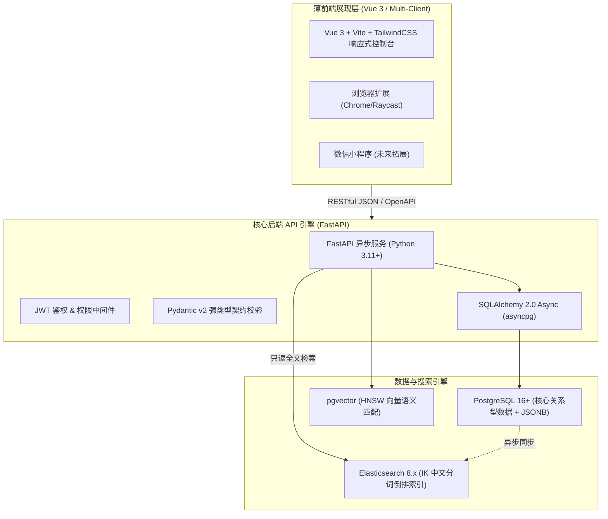

# OpcHub 技术选型与技术栈决策总规划 (Tech Selection Plan)

> **Document Type**: Phase 1 Architecture Decision Report  
> **Metadata**: `intent=BUILD`, `phase=1`, `status=ACCEPTED`, `version=v1.0.0`  
> **Inherits**: `/DESIGN.md`, `hs_dev_docs/_02_feature_spec/_01_human_prd/opchub_mvp_prd.md`

---

## 1. 架构总览与选型矩阵对账

针对 OpcHub “**重后端、薄前端、API-First 多端适配**”的核心定位，全站技术栈已锁定如下：

---

## 2. 核心架构决策记录 (ADR) 清单

| ADR 编号 | 决策领域 | 核心采纳方案 | 核心价值与边界约束 | 文档位置 |
| :--- | :--- | :--- | :--- | :--- |
| **ADR-001** | 全栈开发框架 | **Python 3.11+ (FastAPI) + Vue 3 (Vite)** | 极佳契合 AI/LLM 管道，原生自动化 OpenAPI 契约，薄前端轻量敏捷 | [`ADR-001_core_stack.md`](ADR-001_core_stack.md) |
| **ADR-002** | 主关系型数据库 | **PostgreSQL 16+ + SQLAlchemy 2.0 (asyncpg)** | 原生 JSONB 灵活支持多变政策字段与 Deals 规则，企业级 ACID 强事务 | [`ADR-002_relational_storage.md`](ADR-002_relational_storage.md) |
| **ADR-003** | 向量语义检索 | **PostgreSQL + pgvector (HNSW 索引)** | 单机融合事务与高维向量，无需引入独立向量库，完美支持混合过滤 | [`ADR-003_vector_matching.md`](ADR-003_vector_matching.md) |
| **ADR-004** | 全文搜索引擎 | **Elasticsearch 8.x + IK 中文分词** | 支持政策长文毫秒级检索、高亮显示与分面聚合，读写职责彻底分离 | [`ADR-004_fulltext_search.md`](ADR-004_fulltext_search.md) |

---

## 3. TECH-01 ~ TECH-05 验收对账

- **TECH-01 约束对照**：FastAPI 完美满足高并发异步与 API-First 多端接入；PostgreSQL + pgvector 避免了前期昂贵的多云部署成本；Elasticsearch 保障政务文本检索高信噪比。
- **TECH-02 方案比较**：已对 Python vs Go/Node、PG vs MySQL/Mongo、pgvector vs Milvus、ES vs Meili 完成严密权衡与论证。
- **TECH-03 风险与边界**：PostgreSQL 与 Elasticsearch 数据同步采用异步写入/事务后钩子，保证主事务不受 ES 抖动影响；pgvector 限制在同一 PG 实例内，杜绝跨库一致性风险。
- **TECH-04 依赖版本锁定**：Python 3.11+, FastAPI 0.110+, Vue 3.4+, PG 16+, ES 8.12+。
- **TECH-05 选型状态**：开发者指定并签署，状态置为 **ACCEPTED**。
