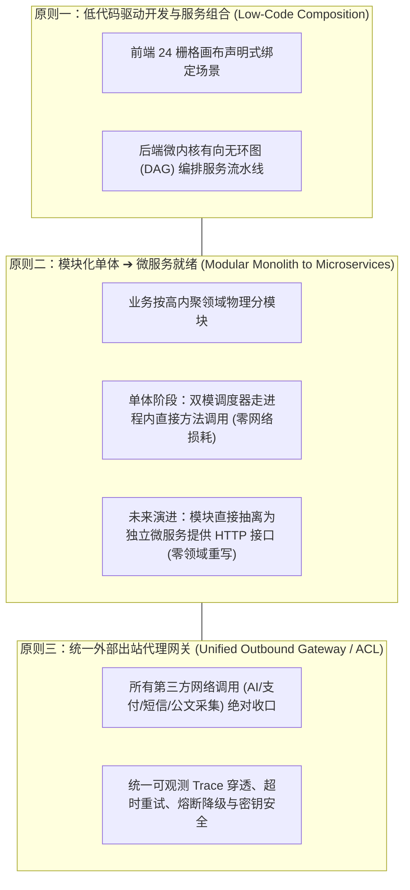
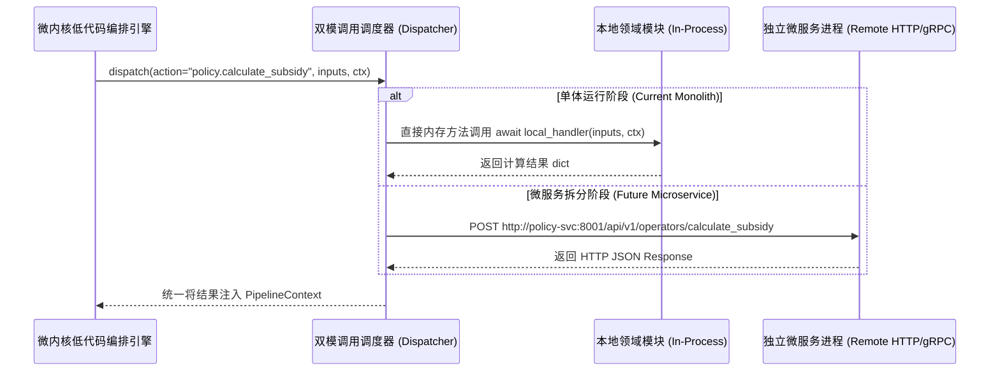

# OpcHub 基于低代码编排的模块化单体与微服务就绪框架设计规范 (Composable Framework Architecture Spec)

> **Document Type**: System Framework & Architecture Blueprint  
> **Inherits**: `/DESIGN.md`, `opchub_system_architecture.md`, `opchub_fullstack_lowcode_engine_spec.md`  
> **Metadata**: `intent=BUILD`, `scope=FRAMEWORK_ARCHITECTURE`, `version=v1.0.0`  
> **Author**: hardstone (Product Owner) & Antigravity (Architecture Partner)  
> **Status**: APPROVED & BINDING (全平台分层分模块与低代码编排技术基准)

---

## 1. 架构核心范式与设计哲学

OpcHub 系统框架设计遵循三大核心战略原则：



1. **服务组合优先于硬编码**：业务场景不是静态铁板一块，而是由各个业务模块向方法中心（`ActionRegistry`）注册的原子算子（Atomic Operators），通过后端微内核 DAG 编排引擎拼装而成；
2. **渐进式演进架构**：初期以单体服务部署，消除分布式网络的网络延迟、数据一致性与运维成本；但每个模块内部完全按微服务自治边界设计，未来仅需切换调度驱动器即可单模块独立容器化上线；
3. **外部依赖防腐收口**：严禁各业务模块私自发起公网 HTTP 请求，所有外部第三方系统访问必须经由统一出站代理网关（`external_gateway`），实现厂商平替、故障隔离与脱网单测打桩。

---

## 2. 系统三层拓扑与通信契约设计

### 2.1 整体分层拓扑结构
```
backend/src/
├── core/                               # 平台微内核基座
│   ├── microkernel/                    # DAG 执行引擎、AST 安全沙箱、动态算子注册中心
│   ├── middleware/                     # 全局 X-Trace-ID 传播、三态健康探针、跨域拦截
│   └── container.py                    # 服务容器与依赖装配中心
│
├── domains/                            # 业务领域模块 (Domain Modules - 微服务就绪)
│   ├── policy/                         # 政策中心域 (提供 calculate, match 等可编排算子)
│   ├── sop/                            # 流程文书域 (提供 render, save 等可编排算子)
│   ├── forum/                          # 创客头脑风暴域 (提供 post, reply, upvote 等可编排算子)
│   ├── demand/                         # 需求集市域 (提供 publish, bid 等可编排算子)
│   ├── product/                        # 产品橱窗域 (提供 showcase, review 等可编排算子)
│   ├── perks/                          # 生态特权域 (提供 claim, verify 等可编排算子)
│   ├── moderation/                     # 内容治理域 (提供 takedown, restore 等可编排算子)
│   └── auth/                           # 用户实名与权益域 (提供 guard, identity 等可编排算子)
│
├── infrastructure/                     # 基础设施层
│   ├── database/                       # 数据库连接会话与升级脚本 (V/U Migration)
│   └── external_gateway/               # 🌟 统一外部出站代理网关 (第三方 API 唯一收口)
│       ├── base_client.py              # 基础出站客户端 (TraceID注入/重试/熔断/脱网Mock)
│       ├── ai_gateway.py               # AI 大模型网关 (Gemini/LLM 统一代理)
│       ├── payment_gateway.py          # 支付结算网关 (微信分账/Stripe/PingPong 跨境托管)
│       ├── sms_auth_gateway.py         # 短信与实名网关 (阿里云/腾讯云验证码)
│       └── gov_crawler_gateway.py      # 政务公开数据采集网关 (限频礼貌爬虫/开放API)
│
└── main.py                             # 单体服务装配入口与 FastAPI 路由挂载
```

---

## 3. 业务模块与低代码平台的接口契约 (Atomic Operators)

### 3.1 模块算子暴露规范
每个模块在 `domains/<module>/` 内部维护私有逻辑，同时对外导出符合微内核标准签名的原子算子：
```python
# 标准微内核原子算子签名：入参字典 + 全局管线上线文 ➔ 异步返回结果字典
ActionHandler = Callable[[dict[str, Any], PipelineContext], Awaitable[dict[str, Any]]]
```

### 3.2 低代码业务流水线组合示例
前端低代码画布中的某个提交按钮（如“开业合规一键申报”），在后端对应一个由低代码编排生成的 Scenario Pipeline：
```yaml
# scenario: OPC_COMPLIANCE_STARTUP_FLOW
scenario: "OPC_COMPLIANCE_STARTUP_FLOW"
description: "一人公司开业全套合规与免税申报流水线"
topology: "DAG"
nodes:
  - id: "step_auth"
    action: "auth.guard"                    # 节点1: 权益与实名校验 (auth 模块)
  - id: "step_tax_calc"
    action: "policy.invoice_tax_calc"       # 节点2: 增值税免征智能判定 (policy 模块)
  - id: "step_ai_charter"
    action: "external.ai.generate_charter"  # 节点3: 委托外部AI网关生成企业章程 (统一外部网关)
  - id: "step_render_sop"
    action: "sop.render_document"           # 节点4: 组装标准商事登记文书 (sop 模块)
  - id: "step_moderation"
    action: "moderation.inspect_content"    # 节点5: 文书敏感合规审查 (moderation 模块)
```

---

## 4. 双模调度器：从单体调用平滑演进至微服务

为保证在拆分微服务时**低代码编排配置与领域核心代码 0 修改**，微内核调度器设计为双模适配模式：



- **切换成本**：从单体剥离某个模块时，仅需将调度配置文件中的该域驱动类型由 `IN_PROCESS` 改为 `HTTP_REMOTE`，无需触动任何业务逻辑。

---

## 5. 统一外部服务出站代理网关规范 (Unified Outbound Gateway Spec)

### 5.1 架构军规
1. **绝对单点收口**：全工程除 `backend/src/infrastructure/external_gateway/` 目录外，任何 `domains/` 或 `core/` 代码中**严禁出现** `requests.`、`httpx.`、`urllib.` 等对公网第三方的直接调用；
2. **统一传递上下文 TraceID**：所有发往公网第三方的请求，底层 `base_client.py` 必须自动将当前请求的 `X-Trace-ID` 注入外发请求头，确保调用日志全链路可追踪；
3. **脱网自测 Mock 机制**：网关提供 `mock_mode` 开关，在本地开发或执行单元测试时自动返回合规模拟数据，无需依赖外部网络与付费 Token。

### 5.2 外部代理分类职责
| 网关适配器 | 对接第三方服务类型 | 核心处理与防腐职责 |
| :--- | :--- | :--- |
| `ai_gateway.py` | Google Gemini API、OpenAI、DeepSeek | 提示词模板组装、Token 消耗计量、敏感词前置初筛、超时回退 |
| `payment_gateway.py` | 微信支付商户分账、Stripe、PingPong 跨境托管 | 报文加签验签、统一分账指令、防资金二清隔离、异步回调通知验真 |
| `sms_auth_gateway.py` | 阿里云短信、腾讯云通信、工商企业三要素核查 | 短信模板变量渲染、验证码防刷频控、实名核验结果归一化 |
| `gov_crawler_gateway.py`| 中国政府网、各省市政务公开网、政务开放数据 API | 遵守 robots 规范、单 IP 请求限频（$\ge 2$s）、自动注入透明爬虫 UA |
