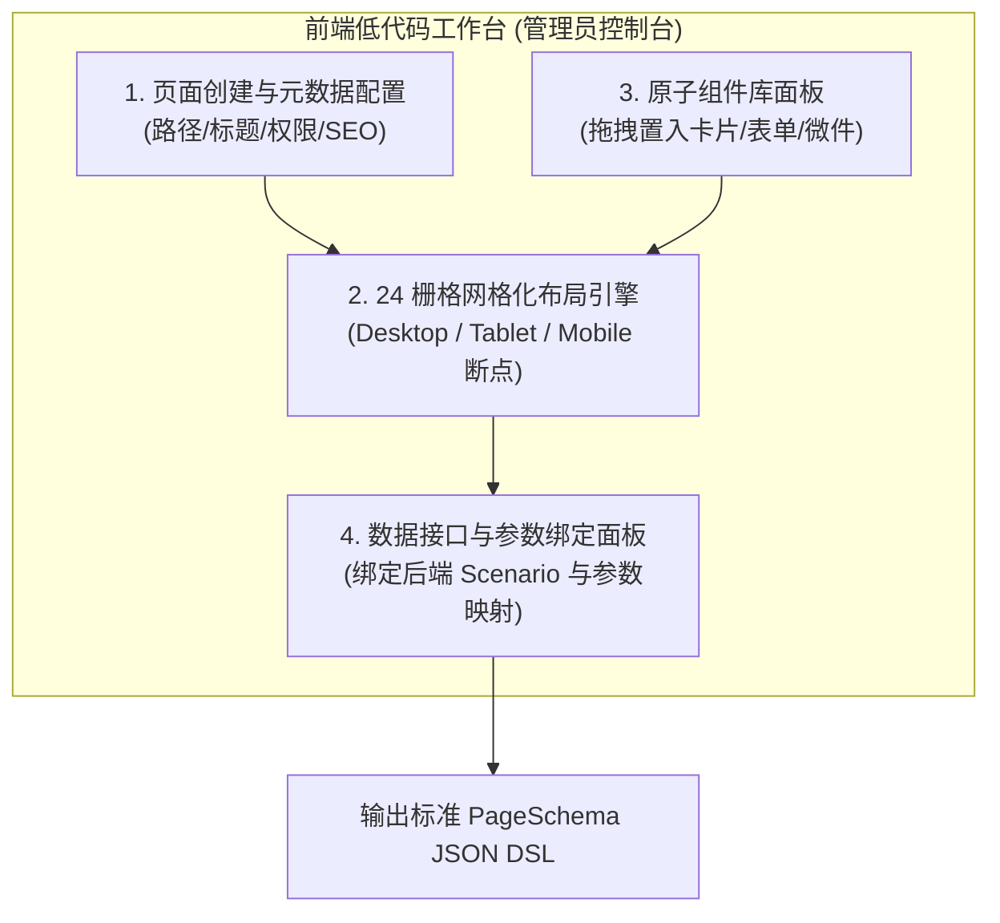
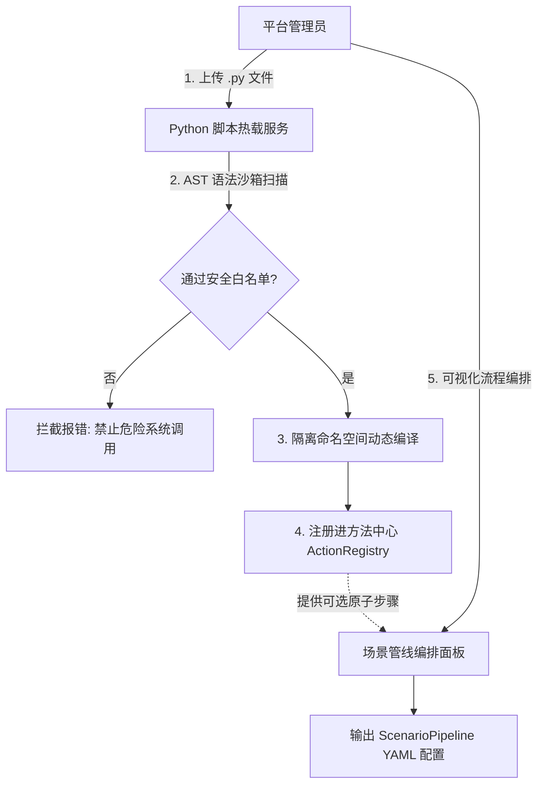
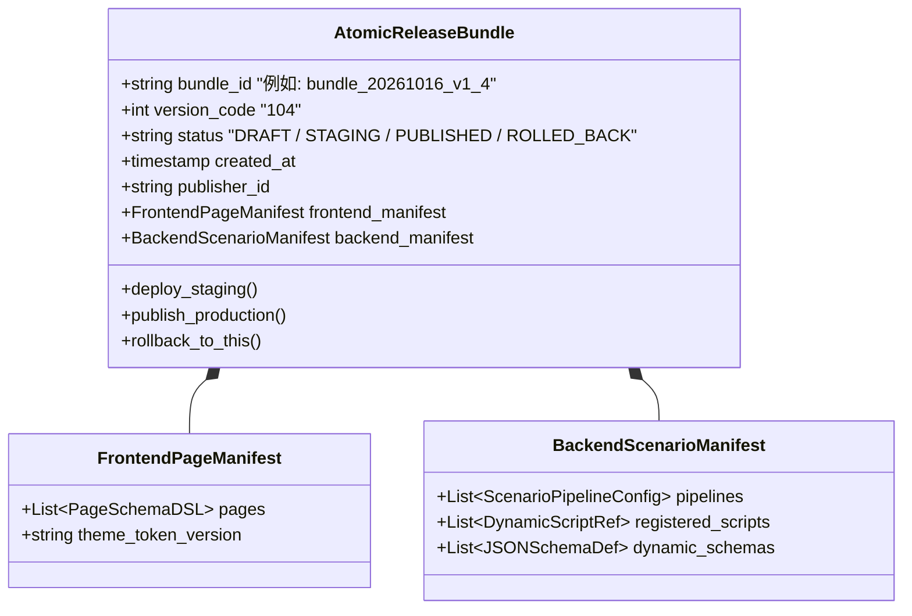

# OpcHub 全栈低代码设计器与统一版本同步上线架构规范 (Full-Stack Low-Code & Sync Release Spec)

> **Document Type**: Phase 2 System Architecture & Low-Code Platform Blueprint  
> **Inherits**: `opchub_system_architecture.md`, `opchub_domain_rich_model.md`, `low_code_metadata_engine_spec.md`  
> **Core Objective**: 实现前端可视化网格页面搭建、接口参数绑定、后端 Python 脚本热载编排，以及前后端原子化版本管理与一键同步发布/回滚。

---

## [VIBE_CONTRACT] 全栈低代码平台执行契约 (Low-Code Architecture Contract)
```yaml
lowcode_platform_contract:
  frontend_designer:
    grid_system: "Responsive_24_Column_Grid (24栅格响应式拖拽布局)"
    binding_protocol: "Declarative_Gateway_Scenario_Binding (声明式场景接口绑定)"
    widget_catalog: "Anthropic_Humanist_Component_Library"
  
  backend_orchestrator:
    pipeline_engine: "ScenarioPipeline_With_AST_Sandbox"
    script_runtime: "Dynamic_Python_Module_Loader"
  
  version_management:
    bundle_pattern: "Atomic_FullStack_Release_Bundle (前后端原子联合发布包)"
    lifecycle_states: ["DRAFT", "STAGING", "PUBLISHED", "ROLLED_BACK", "ARCHIVED"]

guardrails:
  - "MUST: 前端网格布局与后端编排配置必须打包为同一不可分割的原子版本包 (Release Bundle)，严禁出现前端已升级而对应后端编排管线未同步上线的孤岛状态"
  - "MUST: 所有的页面修改、组件拖拽、参数绑定均输出纯 JSON Schema DSL，严禁通过直接修改编译产物或动态插入不受控的 raw HTML/JS"
  - "MUST: 系统必须支持秒级一键回滚 (One-Click Rollback)，回滚时同时切换前后端指向的上一个稳定版本快照"
```

---

## 1. 前端低代码设计器功能全景 (Frontend Visual Designer)



### 1.1 页面创建与元数据定义 (Page Creation)
- **页面属性配置**：页面路由路径（如 `/policy-hub`, `/deals/ai-token`）、页面标题、页面权限级别（`GUEST` / `USER` / `ADMIN`）、布局骨架模板（双列侧边栏布局 / 单列流式 / 全宽仪表盘）；
- **主题 Tokens 继承**：默认强制继承 `/DESIGN.md` Anthropic 风格，支持微调局部内边距与基准容器最大宽度。

### 1.2 页面 24 栅格网格化布局引擎 (Responsive Grid Engine)
- **24 栅格弹性画布**：每个页面划分为标准 24 栅格，支持组件自由拖拽拉伸宽度（如卡片占 8 栅格，一屏放 3 个；占 12 栅格放 2 个；占 24 栅格独占一行）；
- **响应式断点自动折叠**：
  - `Desktop (≥1200px)`: 遵循用户自定义的 24 栅格分配；
  - `Tablet (768px~1199px)`: 超过 12 栅格的组件自动降级换行；
  - `Mobile (<768px)`: 全局自动坍缩为单列纵向流（24 栅格全宽自适应）。

### 1.3 组件库面板与拖拽装配 (Widget Palette)
- **展示型微件 (Display Widgets)**：
  - `PolicyCardWidget`（政策解读卡片，带 100 字白话展示）；
  - `PerkCardWidget`（装备包卡片，带优惠码一键复制）；
  - `GalleryCardWidget`（创客产品卡片，带 Upvote 交互）；
  - `MarkdownArticleWidget`（论坛复盘富文本展示）；
  - `StatisticCounterWidget`（关键数据指标计数器）。
- **交互与表单型微件 (Interactive Widgets)**：
  - `CitySelectorWidget`（城市省市联动选择器）；
  - `SubsidyCalculatorWidget`（补贴条件计算器）；
  - `DynamicFormWidget`（包含单选、多选、输入框、文件上传等低代码表单）；
  - `GlobalSearchInputWidget`（带 `Cmd+K` 弹窗触发的搜索框）。

### 1.4 数据接口与参数绑定引擎 (API & Data Binding)
每个拖入网格的组件，无需手动写 Ajax/Axios 请求，通过设计器侧边栏的**可视化绑定面板**完成装配：
- **场景绑定 (Scenario Binding)**：选择调用的后端统一网关场景（如 `QUERY_POLICY_LIST`、`CALCULATE_SUBSIDY`）；
- **入参绑定 (Request Payload Mapping)**：
  - 可绑定为**静态常量**（如 `city: "hangzhou"`）；
  - 可绑定为**其他组件的输出值**（如从 `CitySelectorWidget.value` 获取城市）；
  - 可绑定为**当前登录用户上下文**（如 `ctx.user.id`、`ctx.user.entity_type`）；
- **出参映射 (Response Data Path)**：
  - 指定将后端返回的哪个 JSON 路径赋值给组件展示（如 `res.data.policies` 赋值给列表，`res.data.total` 赋值给分页）；
- **交互动作流 (Event-Action Mapping)**：
  - 点击事件 ➔ 触发后端场景请求、呼出指定抽屉 (`OPEN_DRAWER`)、弹出 Anthropic 付款弹窗 (`TRIGGER_PAYMENT_MODAL`)、或打开外部链接。

---

## 2. 后端流程编排与 Python 代码热载 (Backend Orchestrator)



### 2.1 动态 Python 脚本热载流程
1. 管理员在后台上传 `calculate_hangzhou_talent_subsidy.py`；
2. 后端执行 **AST 静态安全审查**：扫描禁止的底层模块（`os`, `sys`, `subprocess`）与危险函数（`open`, `eval`, `exec`）；
3. 编译通过后，在沙箱环境中验证入口签名：`async def action_entry(ctx: PipelineContext) -> PipelineContext`；
4. 注册为原子动作 `calculate_hangzhou_talent_subsidy`，无需重启后端服务。

### 2.2 流程编排管线组装
管理员在后台将上述新注册的方法与现有方法串联成业务场景：
```yaml
# 新业务场景配置: HANGZHOU_TALENT_SUBSIDY_CALC
scenario: "HANGZHOU_TALENT_SUBSIDY_CALC"
description: "杭州青年创客专属现金补贴测算管线"
pipeline:
  - "entitlement_guard_step"               # 步骤1: 权限与收费权益守卫
  - "validate_applicant_graduation_years"  # 步骤2: 校验毕业年限
  - "calculate_hangzhou_talent_subsidy"    # 步骤3: 新上传的热载 Python 方法！
  - "format_anthropic_result_card"         # 步骤4: 输出前端卡片元数据
```

---

## 3. 前后端原子发布包与统一版本管理 (Atomic Release Bundle)

为了避免“前端修改了页面网格但后端管线还未发布”，或者“后端上线了新场景但前端还没上架组件”的不一致事故，系统采用**前后端原子联合发布包机制**：



### 3.1 发布生命周期五态流转
1. **DRAFT (草稿态)**：
   - 管理员在前端低代码设计器中拖拽网格、在后端上传脚本与编排流程，所有改动暂存于本地草稿包；
2. **STAGING (预发演练态)**：
   - 点击“提交预发”，系统生成带有唯一指纹的预发版本号（如 `bundle_v1.4-rc1`）；
   - 管理员可在特定预发环境中进行端到端全真模拟测试，不影响现网真实用户；
3. **PUBLISHED (正式发布态)**：
   - 验证无误后，点击“发布上线”；
   - 系统原子化更新 Redis / 内存缓存中的 `ACTIVE_RELEASE_BUNDLE_ID`；
   - 前端向网关发起的每一次初始化或路由切换，自动匹配该版本的页面网格与接口映射；
4. **ROLLED_BACK (一键回滚态)**：
   - 若线上发现任何意外，管理员点击**“一键回滚”**并选择历史版本（如 `bundle_v1.3`）；
   - **毫秒级原子切换**：前后端的活动指向指针瞬间切回 `bundle_v1.3`，页面布局与后端管线瞬时同步降级复原；
5. **ARCHIVED (历史归档态)**：
   - 历史版本留存完整快照，包含当时的页面网格 DSL、脚本代码与管线配置，支持溯源审查。

---

## 4. 完整的页面 DSL 结构示例 (PageSchema JSON DSL)

前端低代码画布保存后，生成的标准 JSON 示例如下：

```json
{
  "bundle_id": "bundle_20261016_v1_4",
  "page_id": "policy_radar_home",
  "route_path": "/policy-radar",
  "title": "政策中心 · 一人公司专属红利",
  "required_role": "GUEST",
  "grid_layout": {
    "columns": 24,
    "rows": [
      {
        "row_id": "row_hero",
        "blocks": [
          {
            "block_id": "blk_calc",
            "span_desktop": 24,
            "span_mobile": 24,
            "widget": "SubsidyCalculatorWidget",
            "data_binding": {
              "scenario": "CALCULATE_SUBSIDY",
              "trigger_event": "on_submit",
              "output_target": "row_results.blk_policy_list"
            }
          }
        ]
      },
      {
        "row_id": "row_results",
        "blocks": [
          {
            "block_id": "blk_policy_list",
            "span_desktop": 16,
            "span_mobile": 24,
            "widget": "DynamicPolicyCardList",
            "data_binding": {
              "scenario": "QUERY_POLICY_LIST",
              "auto_load": true,
              "params_from_store": ["selected_city", "selected_entity"]
            }
          },
          {
            "block_id": "blk_perks_sidebar",
            "span_desktop": 8,
            "span_mobile": 24,
            "widget": "PerksBannerList",
            "data_binding": {
              "scenario": "GET_FEATURED_PERKS",
              "auto_load": true
            }
          }
        ]
      }
    ]
  }
}
```

---

## 5. 核心价值总结

1. **页面开发零编译**：新增活动页、垂直行业专区（如出海专区、AI 独立创客专区），管理员在低代码画布上拉网格、拖组件、绑参数，**10 分钟即可发布一个新页面**；
2. **后端能力无缝供给**：后端研发或专家编写一个专属算法或优惠计算逻辑，上传 Python 文件即可作为新步骤入驻流程编排，供前台任意页面组装调用；
3. **彻底杜绝前后端版本脱节**：以原子发布包（Release Bundle）统一绑定前后端生命周期，支持毫秒级一键回滚，最大化降低一人公司的运维心智负担与故障风险！
