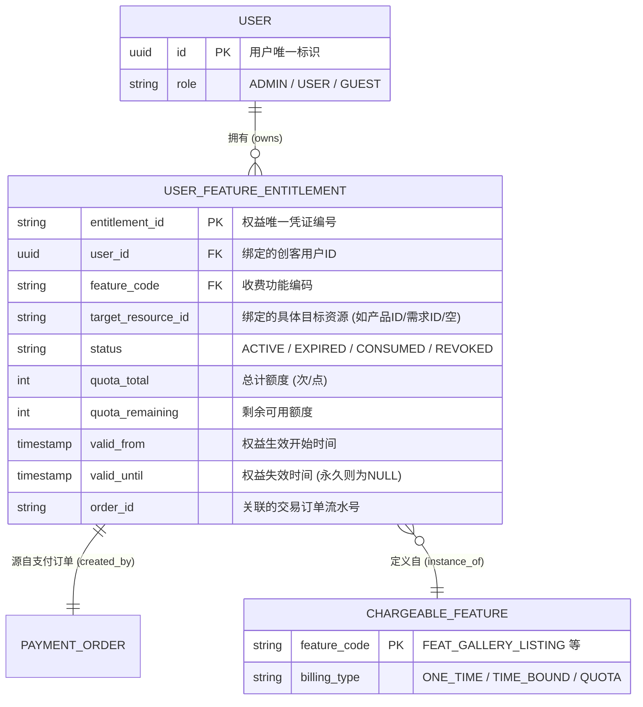
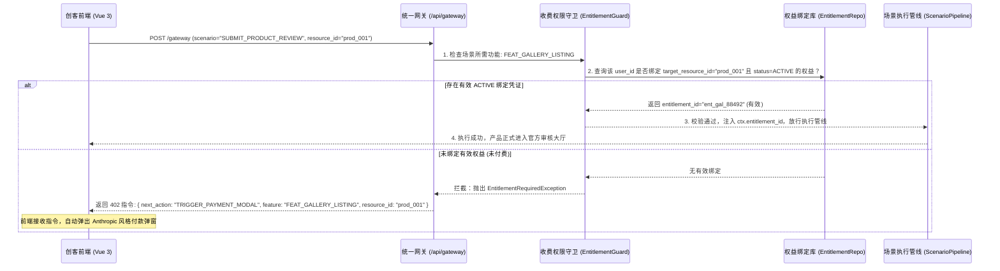

# OpcHub 基于收费功能的权限体系设计：用户与权益ID绑定规范 (Monetization & Entitlement Spec)

> **Document Type**: Phase 2 Security & Monetization Architecture Specification  
> **Inherits**: `opchub_rbac_auth_architecture.md`, `opchub_system_architecture.md`  
> **Core Model**: **User-Entitlement ID Binding Architecture (用户-收费权益ID绑定模型)**

---

## [VIBE_CONTRACT] 收费权限执行契约 (Monetization Guard Contract)
```yaml
entitlement_contract:
  pattern: "User_Feature_Entitlement_Binding (用户-权益凭证绑定)"
  entitlement_id_format: "ent_{feature_prefix}_{uuid8}"
  
  chargeable_features:
    - code: "FEAT_GALLERY_LISTING"
      type: "ONE_TIME_PERPETUAL"     # 终身收录：一个产品绑定一个权益 ID
      desc: "官方产品橱窗永久审核收录与高权重外链"
    - code: "FEAT_GALLERY_BOOST"
      type: "TIME_BOUND"             # 时效特权：周榜/月榜首页置顶打榜
      desc: "产品橱窗首页黄金轮播与置顶展示位"
    - code: "FEAT_VENDOR_CERTIFIED"
      type: "TIME_BOUND_ANNUAL"      # 年度认证：服务商资质年度认证铭牌
      desc: "财税所/独立工作室官方认证背书"
    - code: "FEAT_LEAD_UNLOCK"
      type: "QUOTA_CONSUMABLE"       # 额度消耗：外包商机联系方式单次解锁
      desc: "精准对接创客发布的外包代账与设计需求"
    - code: "FEAT_TRAFFIC_BOOST"
      type: "QUOTA_CREDITS"          # 流量点数：跨站微件去中心化曝光加速
      desc: "免挂微件或零流量产品的流量加速包"

guardrails:
  - "MUST: 针对所有标记为收费点的场景管线，前置拦截器必须先校验 (user_id, feature_code, target_resource_id) 是否绑定有效 ACTIVE 权益"
  - "MUST: 若无有效绑定权益，网关禁止抛出 403 晦涩错误，必须返回 HTTP 402 Payment Required 并携带 TRIGGER_PAYMENT_MODAL 指令驱动前端呼起收银台"
  - "MUST: 权益消耗与核销必须在事务内完成，严禁并发超额消费"
```

---

## 1. 用户与收费权益绑定模型 (Entitlement Data Model)

在传统 RBAC 的基础上，系统引入 **用户-收费功能权益绑定表 (`user_feature_entitlement`)**。每一个付费操作成功后，系统即生成唯一的 `entitlement_id`，并与 `user_id` 形成强绑定关系：



---

## 2. 收费权限判定与场景守卫流程 (Entitlement Guard Flow)

当用户发起带有收费属性的业务场景请求时，统一单入口网关执行如下校验流程：



---

## 3. 后端充血模型：权益校验与核销实现 (Python)

```python
from datetime import datetime, timezone
from enum import Enum
from typing import Optional

class EntitlementStatus(str, Enum):
    ACTIVE = "ACTIVE"
    EXPIRED = "EXPIRED"
    CONSUMED = "CONSUMED"
    REVOKED = "REVOKED"

class UserFeatureEntitlement:
    """用户收费权益充血实体"""
    def __init__(
        self,
        entitlement_id: str,
        user_id: str,
        feature_code: str,
        target_resource_id: Optional[str] = None,
        valid_until: Optional[datetime] = None,
        quota_remaining: int = 1,
        status: EntitlementStatus = EntitlementStatus.ACTIVE
    ):
        self.entitlement_id = entitlement_id
        self.user_id = user_id
        self.feature_code = feature_code
        self.target_resource_id = target_resource_id
        self.valid_until = valid_until
        self.quota_remaining = quota_remaining
        self.status = status

    def is_valid(self, target_resource: Optional[str] = None) -> bool:
        """充血方法：自校验该权益凭证对指定目标是否可用"""
        if self.status != EntitlementStatus.ACTIVE:
            return False
            
        # 校验时效性
        if self.valid_until and datetime.now(timezone.utc) > self.valid_until:
            self.status = EntitlementStatus.EXPIRED
            return False

        # 校验额度
        if self.quota_remaining <= 0:
            self.status = EntitlementStatus.CONSUMED
            return False

        # 校验绑定的特定目标资源（如特定产品ID）
        if self.target_resource_id and target_resource:
            if self.target_resource_id != target_resource:
                return False

        return True

    def consume(self, amount: int = 1):
        """充血方法：扣减额度或置为已使用"""
        if not self.is_valid():
            raise InvalidEntitlementError("当前权益凭据已失效或已耗尽")
        
        self.quota_remaining -= amount
        if self.quota_remaining <= 0:
            self.status = EntitlementStatus.CONSUMED
```

---

## 4. 网关原子步骤：收费权限拦截器 (Pipeline Step)

所有收费业务场景在编排配置中，第一步统一声明 `entitlement_guard_step`：

```python
async def entitlement_guard_step(ctx: PipelineContext) -> PipelineContext:
    """管线原子步骤：统一收费权益拦截与引导"""
    feature_code = ctx.state.get("required_feature_code")
    target_resource = ctx.input_payload.get("resource_id")

    # 查询当前用户是否已绑定该收费功能的有效 ID
    entitlement_repo = ctx.state["entitlement_repo"]
    active_ent = await entitlement_repo.find_active_entitlement(
        user_id=ctx.user_id,
        feature_code=feature_code,
        target_resource=target_resource
    )

    if not active_ent or not active_ent.is_valid(target_resource):
        # 中断执行并告知前端呼起收银台
        ctx.halt("此功能属于收费增值项目，尚未检测到您名下有效的付费权益凭证")
        ctx.next_action = {
            "action_type": "TRIGGER_PAYMENT_MODAL",
            "params": {
                "feature_code": feature_code,
                "target_resource_id": target_resource,
                "user_id": ctx.user_id
            }
        }
        return ctx

    # 将有效权益 ID 注入上下文供后续业务落库与审计
    ctx.state["bound_entitlement_id"] = active_ent.entitlement_id
    return ctx
```

---

## 5. 商业闭环与支付回调绑定机制

```text
1. 用户在前端触发收费功能（无有效权益 ID）；
2. 网关返回 TRIGGER_PAYMENT_MODAL 驱动前端弹出支付弹窗；
3. 用户完成支付（微信/支付宝/Stripe）；
4. 支付成功回调：
   a. 生成并落盘 PaymentOrder；
   b. 颁发全新唯一 entitlement_id；
   c. 将 (entitlement_id, user_id, feature_code, resource_id) 写入绑定表，置为 ACTIVE；
5. 前端自动无感重试原始场景请求，网关 EntitlementGuard 校验通过，业务管线顺利贯通！
```
