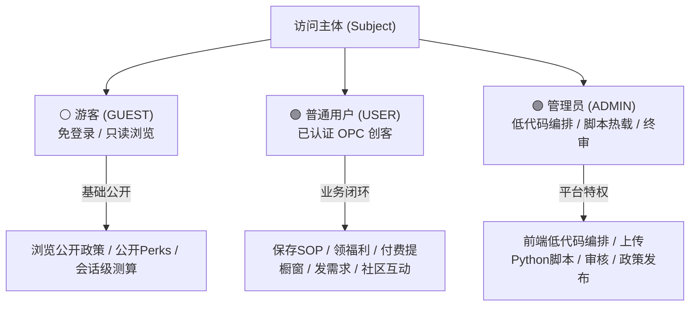

# OpcHub 三级用户与混合权限体系设计规范 (User Hierarchy & RBAC/ABAC Spec)

> **Document Type**: Phase 2 Security & Permission Architecture Specification  
> **Inherits**: `opchub_system_architecture.md`  
> **Target**: 构建管理员、普通用户、游客三级分层模型，兼顾页面编排、脚本上传与资源归属安全

---

## [VIBE_CONTRACT] 权限系统执行契约 (Security Contract)
```yaml
security_contract:
  auth_pattern: "Stateless_JWT_With_RBAC_ABAC_Guards"
  user_roles:
    - role: "ADMIN"
      desc: "超级管理员：拥有低代码页面编排、Python脚本上传热加载、全局数据发布与审核权限"
    - role: "USER"
      desc: "已认证 OPC 创客：拥有向导追踪、福利申领、付费橱窗提交、外包发布与社区发帖权限"
    - role: "GUEST"
      desc: "匿名游客：纯只读公开浏览与会话级免登录试算，无写库与申领权限"

guardrails:
  - "MUST: 网关在调度编排管线前，必须首先执行前置 RBAC 权限校验；未登录游客执行写操作必须返回统一指令引导登录"
  - "MUST: 针对修改/删除自身产品、修改自身外包需求的场景，必须执行 ABAC 资源归属校验 (Owner Check)"
  - "MUST: Python 脚本上传接口 (`POST /api/v1/scripts/upload`) 必须仅对 ADMIN 开放，并记录不可篡改的审计日志"
```

---

## 1. 三级用户体系角色与权限矩阵 (Role & Permission Matrix)



### 1.1 权限细粒度对照表

| 权限标识 (Permission Code) | 权限描述 | 游客 (GUEST) | 普通创客 (USER) | 管理员 (ADMIN) |
| :--- | :--- | :---: | :---: | :---: |
| `policy:read_public` | 浏览公开政策列表与精简白话摘要 | ✅ | ✅ | ✅ |
| `policy:calc_ephemeral` | 会话级匿名使用补贴计算器（不落盘） | ✅ | ✅ | ✅ |
| `policy:read_detail` | 查看官方文号、完整细则与申报材料清单 | ❌ (引导登录) | ✅ | ✅ |
| `sop:save_progress` | 勾选并持久化保存 SOP 向导进度 | ❌ | ✅ | ✅ |
| `perk:claim_coupon` | 申领大厂专属优惠码（防刷限制） | ❌ | ✅ | ✅ |
| `gallery:submit` | 提交独立产品至橱窗（需支付审核费） | ❌ | ✅ | ✅ |
| `gallery:upvote` | 对产品进行 Upvote 点赞（防刷） | ❌ | ✅ | ✅ |
| `market:create_demand` | 发布外包代账与设计需求 | ❌ | ✅ | ✅ |
| `market:vendor_apply` | 申请成为认证服务商（财税所/工作室） | ❌ | ✅ | ✅ |
| `forum:post_comment` | 论坛发帖、复盘分享与发表评论 | ❌ | ✅ | ✅ |
| `page:orchestrate` | **低代码编排前端页面与微件槽位布局** | ❌ | ❌ | ✅ |
| `data:schema_manage` | **新增/修改动态业务元数据与发布数据** | ❌ | ❌ | ✅ |
| `script:upload_python` | **上传 Python 脚本文件并注册到后端微内核** | ❌ | ❌ | ✅ |
| `review:audit_all` | 审核橱窗产品、审核服务商认证资质 | ❌ | ❌ | ✅ |

---

## 2. 混合权限控制模型：RBAC + ABAC 双重护栏

系统在统一单入口网关层采用 **RBAC (角色判定) + ABAC (属性与归属判定)** 的两级防线：

```text
客户端请求 (POST /api/v1/gateway)
        │
        ▼ 
[ 1. 认证提取 (JWT Authenticator) ] ── 未携带 Token ➔ 赋予 GUEST 匿名上下文
        │
        ▼ 
[ 2. RBAC 静态角色校验 ] ── 场景所需权限 ∈ 用户角色权限集？ ── 否 ──► 抛出 403 / 引导登录
        │ 是
        ▼ 
[ 3. ABAC 动态属性校验 (Owner / State Guard) ]
        ├── 资源归属校验：ctx.payload.resource_id.owner == ctx.user_id ？
        └── 状态流转校验：当前状态是否允许执行此操作（如已通过审核的产品不可随意篡改）
        │ 是
        ▼ 
[ 进入业务 Scenario 流程管线执行 ]
```

### 2.1 ABAC 策略拦截器代码实现 (Python)
在管线中可作为通用的前置原子步骤挂载：

```python
async def abac_owner_guard(ctx: PipelineContext) -> PipelineContext:
    """ABAC 动态策略：严格校验资源归属权"""
    if ctx.user_role == "ADMIN":
        return ctx  # 管理员具备全局通配特权

    resource_type = ctx.input_payload.get("resource_type")
    resource_id = ctx.input_payload.get("resource_id")
    
    # 从数据库或缓存拉取资源所有者
    owner_id = await get_resource_owner(resource_type, resource_id)
    if owner_id != ctx.user_id:
        ctx.halt("权限拒绝：您无权修改或操作非本人拥有的资产")
        
    return ctx
```

---

## 3. 管理员特权：前端低代码编排与 Python 脚本热载安全链

### 3.1 前端低代码页面编排流 (Low-Code Orchestration)
管理员在专属控制台中操作：
1. **组件槽位配置**：自由选择页面的 Block 布局（如将政策中心调整到首页顶部，更换侧边栏 Perks Banner）；
2. **Schema 属性发布**：无需后端工程师改表，通过界面在线填入新政策数据并绑定动态 Schema（如添加“免税专属测算公式”）；
3. **数据生效广播**：提交后系统更新 `SchemaRegistry` 缓存，所有前端用户刷新或下一次请求即时生效。

### 3.2 Python 脚本安全上传与热注册机制 (Dynamic Script Ingestion)
针对管理员上传自定义业务处理脚本的场景，设计四道安全防火墙：

```text
[ 管理员上传 .py 文件 ]
       │
       ▼
【第 1 道：AST 静态词法语法深度沙箱扫描】
  • 严禁 import os, sys, subprocess, shutil, socket 等破坏性底层系统库
  • 严禁调用 open, eval, exec, compile, __import__ 等反射逃逸函数
       │ 通过
       ▼
【第 2 道：签名与入口规约核验】
  • 必须导出合规入口：async def action_entry(ctx: PipelineContext) -> PipelineContext
       │ 通过
       ▼
【第 3 道：受限隔离执行命名空间编译加载】
  • 剥离危险内置全局变量，仅注入受控的数据操作集合
       │ 通过
       ▼
【第 4 道：注册进 ActionRegistry 并落盘审计日志】
  • 生成安全哈希指纹，记录操作者管理员 ID 与时间戳，供场景管线配置挂载
```
