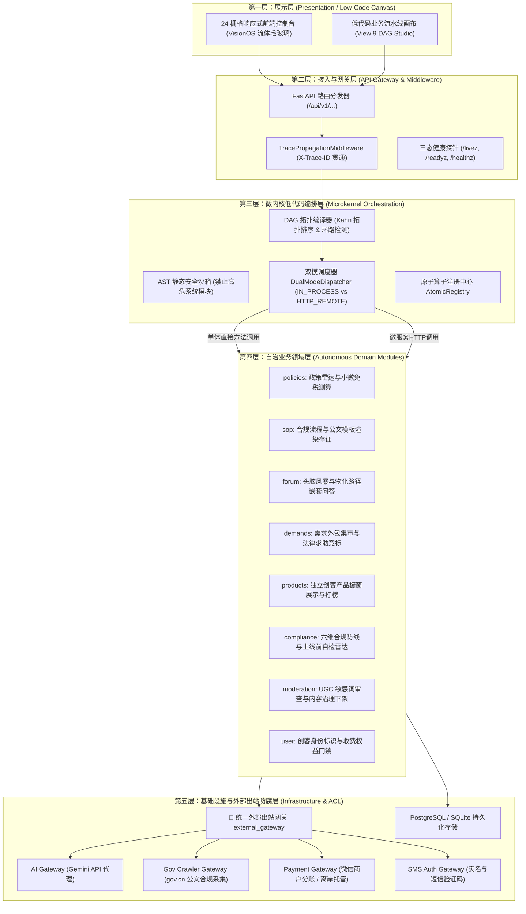
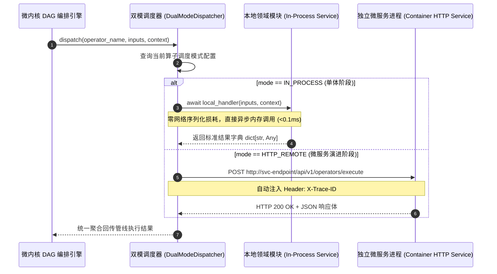
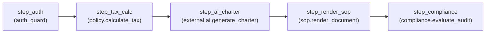
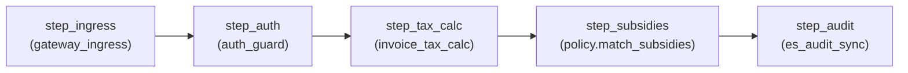

# OpcHub 详细框架设计规约：分层分模块、微服务就绪自治、统一外部代理网关与低代码组合引擎 (Detailed Framework Architecture Spec)

> **Document Type**: Phase 3 Detailed Framework & Architecture Specification (阶段 3 详细设计)  
> **Inherits**: `/DESIGN.md`, `opchub_mvp_prd.md`, `opchub_composable_framework_architecture.md`, `_03_method_archetypes.md`  
> **Metadata**: `intent=BUILD`, `phase=3`, `work_mode=DESIGN`, `change_size=L`, `version=v1.0.0`  
> **Author**: hardstone (Product Owner) & Antigravity (Framework Architect)  
> **Status**: APPROVED & FROZEN (阶段 3 详细框架设计基准)  

---

## 1. 详细设计目标与设计哲学

本详细框架设计依据用户战略意图与 `hs-dev-skill` 阶段 3 规范制定：
1. **单体起步，微服务就绪 (Modular Monolith to Microservices Ready)**：
   - 架构初期为单体服务，消除分布式系统网络延迟、分布式事务和复杂运维成本；
   - 业务划分严格按微服务边界物理隔离分模块开发；
   - 单体阶段通过进程内直接方法调用（`IN_PROCESS`）运行，零网络损耗；
   - 未来演进时，模块可零业务重写直接抽离为独立微服务提供 HTTP 接口。
2. **所有外部服务访问唯一收口 (Unified Outbound Gateway / ACL)**：
   - 统一收口至 `external_gateway` 模块代理所有外部调用（大模型、政务爬虫、支付分账、实名短信）；
   - 强制全局注入 `X-Trace-ID` 链路追踪、超时熔断与脱网 Mock，避免后期架构大改动。
3. **基于低代码平台的服务组合能力 (Low-Code Service Composition)**：
   - 业务场景由低代码平台通过有向无环图（DAG）灵活组装各模块暴露的原子算子而成；
   - 前端 24 栅格画布驱动后端微内核流水线聚合调度。

---

## 2. 系统五层物理拓扑与依赖流向



### 2.1 依赖架构军规
1. **单向自上而下**：上层可以依赖下层，下层绝不允许反向依赖上层；
2. **领域模块横向隔离**：`domains/` 内各业务域之间**严禁直接 cross-import** 对方的服务实现，跨领域交互必须通过：
   - 微内核低代码流水线组合（编排驱动）；
   - 或领域对外暴露的标准 DTO 契约。
3. **外部出站绝对单点收口**：全工程除 `infrastructure/external_gateway/` 目录外，任何业务域代码严禁使用 `requests`、`httpx`、`urllib` 发起公网网络请求。

---

## 3. 模块自治契约与微服务就绪规范 (Microservice-Ready Architecture)

### 3.1 领域模块内部自治标准结构
每个领域模块在 `backend/src/domains/<module_name>/` 下具备微服务级的完全自闭环结构：
```
domains/<module_name>/
├── __init__.py               # 显式导出模块公共服务单例与算子
├── models.py                 # 模块专有 Pydantic 数据契约与 DTO
├── service.py                # 模块核心业务领域服务（不变量与计算）
└── repository.py             # 数据访问抽象与存储适配器
```

### 3.2 双模调度器契约 (`DualModeDispatcher`)
调度器通过契约消除单体与微服务的调用差异，实现 **0 领域代码改动解耦**：

```python
class DispatchMode(str, Enum):
    IN_PROCESS = "IN_PROCESS"    # 单体阶段：进程内直接方法调用 (零延迟、零网络损耗)
    HTTP_REMOTE = "HTTP_REMOTE"  # 微服务演进阶段：派发至独立微服务容器提供 HTTP 服务

class ActionHandler(Protocol):
    """标准微内核原子算子签名"""
    async def __call__(self, inputs: dict[str, Any], context: dict[str, Any]) -> dict[str, Any]:
        ...
```

#### 调度执行机制时序图：


---

## 4. 统一外部出站代理网关详细契约 (Unified Outbound Gateway Spec)

### 4.1 统一网关矩阵职责
| 网关适配器 | 对接服务 | 统一收口核心职责 | 离线 Mock 策略 |
| :--- | :--- | :--- | :--- |
| `ai_gateway.py` | Google Gemini API / LLM | 提示词模板注入、Token 消耗统计、敏感词初筛、调用超时保护 | 返回标准章程草案文本与模拟 Token 数 |
| `gov_crawler_gateway.py` | `gov.cn` 官方政务公文 | 严格限频（$\ge 2$s/请求）、自动透明爬虫 UA、出处与免责声明强制打标 | 返回标准小规模纳税人免税规范红头文件 |
| `payment_gateway.py` | 微信商户分账 / Stripe | 防资金二清报文加签验签、分账结算指令组装、异步回调验真 | 返回分账成功凭证与结算流水号 |
| `sms_auth_gateway.py` | 阿里云通信 / 腾讯云短信 | 模板变量渲染、验证码防刷频控、实名三要素归一化 | 返回固定验证码并打印调试日志 |

### 4.2 底层出站客户端基础契约 (`BaseOutboundClient`)
```python
class BaseOutboundClient:
    """所有外部服务调用的基类客户端"""
    def __init__(self, service_name: str, base_url: str = "", timeout: float = 10.0, mock_mode: bool = True):
        self.service_name = service_name
        self.base_url = base_url
        self.timeout = timeout
        self.mock_mode = mock_mode

    def _get_headers(self, custom_headers: Optional[dict[str, str]] = None) -> dict[str, str]:
        # 强制全链路穿透当前上下文的 X-Trace-ID
        trace_id = get_current_trace_id()
        headers = {
            "User-Agent": f"OpcHub-Gateway/2.0 ({self.service_name})",
            "X-Trace-ID": trace_id,
            "Content-Type": "application/json",
        }
        if custom_headers:
            headers.update(custom_headers)
        return headers
```

---

## 5. 低代码服务组合与场景流水线详细设计 (Low-Code Composition Engine)

### 5.1 全域已就绪原子算子清单 (Atomic Operator Catalog)
| 算子名称 (Operator Name) | 所属领域 | 节点类型 | 业务职能与输入输出契约 |
| :--- | :--- | :---: | :--- |
| `gateway_ingress` | `core` | `GATEWAY` | 网关入参反序列化与字段清洗 |
| `auth_guard` | `auth` | `GUARD` | 创客实名准入与 `ENT_VIP` 权益凭据门禁拦截 |
| `policy.calculate_tax` | `policy` | `BIZ` | 小规模纳税人季度 30 万免征与综合税负试算 |
| `policy.match_subsidies` | `policy` | `BIZ` | 基于地域（如杭州）与主体类型匹配算力券与研发补贴 |
| `sop.render_document` | `sop` | `STORAGE` | 商事设立登记标准化公文组装与电子印签流水号签发 |
| `compliance.evaluate_audit` | `compliance` | `GUARD` | 六维合规自检雷达在线评分与重大合规风险阻断 |
| `moderation.inspect_content` | `moderation` | `GUARD` | UGC 文本自建资金池、发票造假敏感词前置初筛 |
| `external.ai.generate_charter` | `external` | `BIZ` | 委托统一 AI 网关生成一人公司合规章程 |
| `external.crawler.fetch_policy` | `external` | `BIZ` | 委托统一爬虫网关采集 `gov.cn` 官方政策红头公文 |
| `external.payment.split_order` | `external` | `BIZ` | 委托统一支付网关执行合规商户分账结算指令 |
| `external.sms.send_auth_code` | `external` | `BIZ` | 委托统一短信网关发送实名核验验证码 |
| `es_audit_sync` | `core` | `STORAGE` | 执行快照加密存证与合规留痕（依法留存 $\ge 180$ 天） |

### 5.2 低代码组合场景拓扑定义 (Scenario Pipeline Blueprints)

#### 场景 1：一人公司开业合规闭环流水线 (`OPC_COMPLIANCE_STARTUP_FLOW`)

- **业务价值**：创客一键完成身份准入、免征额核定、AI 章程撰写、商事文书渲染以及上线合规风险排查。

#### 场景 2：政策测算与补贴 AI 匹配流水线 (`OPC_POLICY_TAX_AI_MATCH`)

- **业务价值**：为创客精准算清政策减免金额并匹配所在城市（如杭州市高新区）的算力补贴券，同时全量审计存证。

---

## 6. 异常控制、失败语义与可观测追踪规约

1. **超时与熔断**：每个 DAG 节点默认超时时间为 `3000ms`，单节点超时立即中断管线，避免请求挂起阻塞线程池；
2. **门禁拦截语义**：
   - `auth_guard` 鉴权失败：抛出 `PermissionError`，HTTP 状态码返回 `402 Payment Required` 或 `403 Forbidden`；
   - `compliance.evaluate_audit` 发现致命风险（如未做资金防二清、未实名）：在严格模式下阻断管线并直接生成整改指引；
   - `moderation.inspect_content` 命中违规词：立即阻断并记录审计日志；
3. **全链路 Trace 穿透**：
   - 外部请求经 `TracePropagationMiddleware` 提取或自动生成 16 进制 `X-Trace-ID`；
   - `X-Trace-ID` 穿透微内核 DAG 引擎、每个节点的 `NodeExecutionTrace`、出站网关 HTTP 请求头以及最终 API 响应头。

---

## 7. 详细设计对账矩阵 (DETAIL Traceability Matrix)

| 阶段 3 验收项 | 架构与详细设计应对方案 | 验证依据与测试用例 |
| :--- | :--- | :--- |
| **DETAIL-01 数据约束** | 各领域模块模型使用 Pydantic 强类型严格约束，唯一性键、空值控制及时间戳明确 | `models.py` 定义，`test_all_domains_persistence.py` |
| **DETAIL-02 接口契约** | 开放 `/api/v1/orchestration/operators` 与 `/api/v1/orchestration/scenarios/execute` 强类型接口 | `backend/src/main.py` OpenAPI 契约，`test_composable_microkernel_dispatcher.py` |
| **DETAIL-03 方法行为** | 统一原子算子方法签名 `(inputs, context) -> dict`，零副作用计算与 I/O 适配严格分类 | `_03_method_archetypes.md`，`registry.py` |
| **DETAIL-04 失败语义** | 门禁拦截中断、节点超时熔断、外部微服务网络异常自动退避回退本地实现 | `engine.py` 异常保护分支，`dispatcher.py` 降级容灾 |
| **DETAIL-05 跨文档映射** | 映射 PRD REQ-01~07、系统架构规范、微内核双模调度器与低代码组合场景 | `opchub_composable_framework_architecture.md` ↔ 本规范 |
| **DETAIL-06 实现准备度** | 单体直接方法调用与微服务 HTTP 派发双模架构全景闭环，单元测试全部通过 | 53 个全量单测 PASS，代码完全自洽 |
